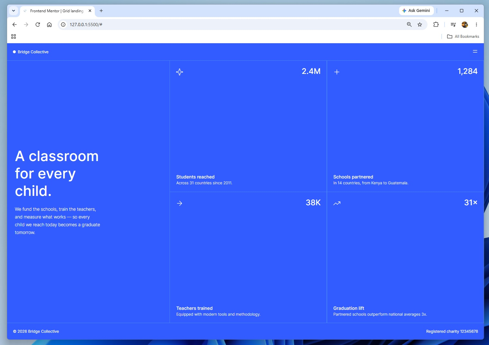

# Frontend Mentor - grid landing page solution

This is a solution to the [grid landing page challenge on Frontend Mentor](https://www.frontendmentor.io/challenges/grid landing page). Frontend Mentor challenges help you improve your coding skills by building realistic projects. 

## Table of contents

- [Overview](#overview)
  - [The challenge](#the-challenge)
  - [Screenshot](#screenshot)
  - [Links](#links)
- [My process](#my-process)
  - [Built with](#built-with)
  - [What I learned](#what-i-learned)
  - [AI Collaboration](#ai-collaboration)

## Overview

### The challenge

Users should be able to:

- View the optimal layout depending on their device's screen size

### Screenshot

### Links

- Solution URL: [https://github.com/Acemeistre/FEM_grid-landing-page]
- Live Site URL: [https://acemeistre.github.io/FEM_grid-landing-page]

## My process

### Built with

- Semantic HTML5 markup
- CSS custom properties
- Flexbox
- CSS Grid

### What I learned

#### Achievements 

- Building mobile-first now feels natural: I write the stacked layout as the base styles, then add `min-width` queries for tablet and desktop.
- I switched to writing commit messages in the imperative style ("Add...", "Fix..."), which is the convention.

#### Challenges

- To build the dropdown menu without JavaScript it's best to use `
` and `
`, and swap the burger icon for an X using the `[open]` attribute.
- Use `:has()` to alter the opacity of the main page behind an open menu.
- The dropdown panel collapsed to zero height because `top: 100%` and `bottom: 0` met at the same point. Removing `bottom` let it size to its content.
- The logo dot sat too low as a text character, so I drew it with `::before` and `border-radius: 50%` instead.

#### Continued development/help

- Are there conventions for the order in which to lay our my css and the order in which to code when dealing with drop down menus?
- Practise Grid until placing items inside a card comes without help.

## AI Collaboration

- Tools used - Claude.
- Used for - debugging and brainstorming solutions.
